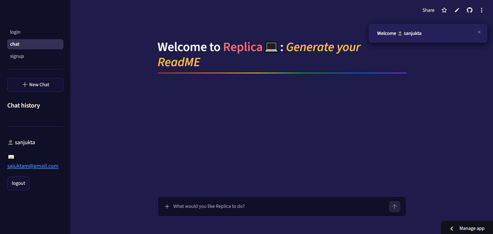
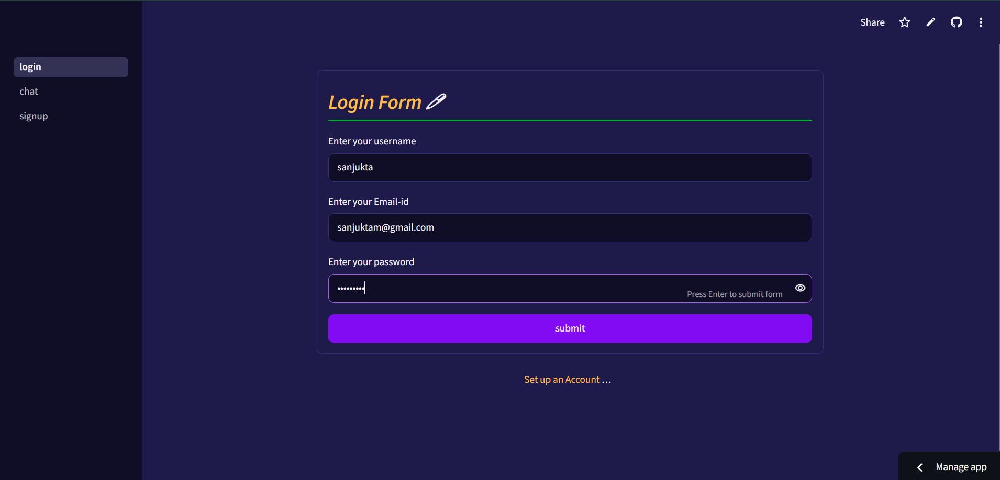
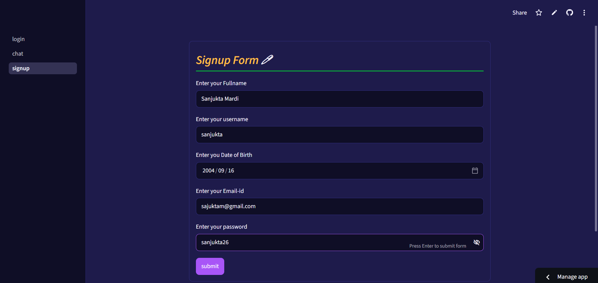

# Replica

> **🚧 Development Notice:** Replica is actively being improved. Certain AI-powered features may be temporarily unavailable during development.

## Overview

Replica is an AI-powered assistant that analyzes GitHub repositories, generates README documentation, and helps identify and fix minor bugs in your code.

## Features

- Agentic GitHub repository analysis.
- AI-generated, editable README documentation delivered as a `.docx` file.
- Bug and error investigation with actionable fix guidance.

## How It Works

Replica is built using an Agno multi-agent team operating in coordinate mode, where specialized agents collaborate to handle different tasks.

Manager: Coordinates the Analyst and Writer agents and manages the overall workflow.

Analyst: Investigates GitHub repositories using GitHub tools such as get_repository, get_repository_languages, list_branches, get_directory_content, and get_file_content. It gathers verified repository information for documentation generation and bug investigation.

Writer: Uses the Analyst's findings to generate professional README documentation.

## Tech Stack

- Python
- agno
- openai
- PyGithub
- greenlet
- streamlit
- reportlab
- SQLAlchemy
- python-docx
- python-dotenv
- mysql-connector-python

## Installation

```bash
pip install -r requirements.txt
```

## Usage

```bash
streamlit run UI/login.py
```

## Project Structure

```
.
├── .streamlit/
│   └── config.toml
├── AgenticAI/
│   ├── __init__.py
│   └── agents.py
├── certs/
│   └── ca.pem
├── chat_history_db/
│   ├── chat_db.py
│   └── history_db.sql
├── UI/
│   ├── pages/
│   │   ├── chat.py
│   │   └── signup.py
│   ├── login.py
│   └── login_database.sql
├── .env.example
├── .gitignore
├── __init__.py
└── requirements.txt
```
## User Interface (UI)
### 1.***Chat Interface***


### 2.***Login Interface***


### 3.***Signup Interface***


## Feedback and Contributions

### Thank you for taking the time to explore Replica!

If you encounter any bugs, identify issues, or have ideas for new features and improvements, feel free to connect with me. Your feedback and suggestions are always welcome!

I'd love to hear your thoughts and make Replica better. 😊