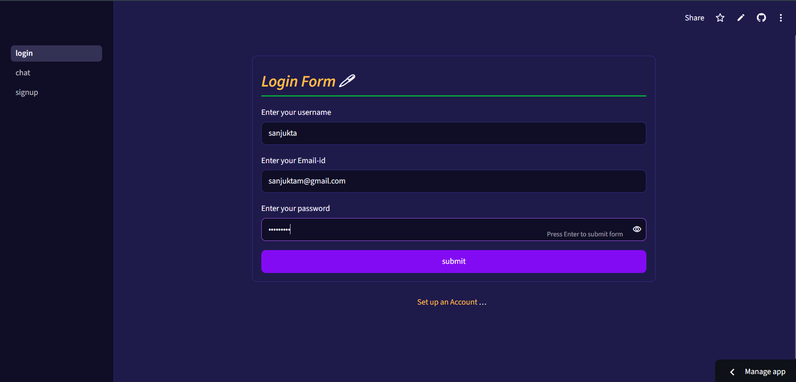

# Replica

## Overview

Replica is an AI-powered GitHub repository assistant that analyzes repositories, generates professional README documentation, and helps investigate bugs and errors by providing actionable fix suggestions.

## Features

- **Agentic GitHub Repository Analysis:** Analyzes repository information, files, directories, branches, and programming languages.
- **AI-Generated README Documentation:** Generates structured, editable README documentation in Markdown format.
- **Bug and Error Investigation:** Examines code and helps identify potential issues with actionable fix guidance.
- **Multi-Agent Collaboration:** Uses specialized AI agents to coordinate repository analysis and documentation generation.

## How It Works

Replica is built using an Agno multi-agent team operating in coordinate mode, where specialized agents collaborate to complete repository-related tasks.

### Manager

Coordinates the Analyst and Writer agents, manages task delegation, and oversees the overall workflow.

### Analyst

Investigates GitHub repositories using GitHub tools, including:

- `get_repository`
- `get_repository_languages`
- `list_branches`
- `get_directory_content`
- `get_file_content`

It gathers verified repository information for README generation and bug investigation.

### Writer

Uses the Analyst's findings to generate professional, structured README documentation in Markdown format.

## Tech Stack

- **Programming Language:** Python
- **AI Agent Framework:** Agno
- **LLM Integration:** OpenAI-compatible APIs
- **GitHub Integration:** PyGithub
- **User Interface:** Streamlit
- **Database:** MySQL, SQLAlchemy
- **Document Generation:** ReportLab, python-docx
- **Environment Management:** python-dotenv
- **Additional Dependencies:** greenlet, mysql-connector-python

## Installation

### 1. Clone the Repository

```bash
git clone https://github.com/sanjuktamardi/Replica-AI-README-Generator.git
cd Replica-AI-README-Generator
```

### 2. Create a Virtual Environment

```bash
python -m venv .venv
```

Activate it:

**Windows:**
```bash
.venv\Scripts\activate
```

**Linux/macOS:**
```bash
source .venv/bin/activate
```

### 3. Install Dependencies

```bash
pip install -r requirements.txt
```

### 4. Configure Environment Variables

Create your local `.env` file using `.env.example` as a reference and configure the required database credentials.

Configure your Streamlit secrets in `.streamlit/secrets.toml`.

Do not commit your actual credentials, API keys, or passwords to GitHub.

### 5. Run the Application

```bash
streamlit run UI/login.py
```

## Docker Setup

Replica also supports containerized deployment using Docker and Docker Compose.

### Build and Start Containers

```bash
docker compose -f replica_compose.yaml up --build
```

### Stop Containers

```bash
docker compose -f replica_compose.yaml down
```

The Streamlit application runs on port `8501`, while MySQL runs in a separate container with persistent storage.

## Project Structure

```text
.
├── .streamlit/
│   └── config.toml
├── AgenticAI/
│   ├── Instructions/
│   │   ├── analyst_agent.txt
│   │   ├── manager_agent.txt
│   │   └── writer_agent.txt
│   ├── __init__.py
│   └── agents.py
├── chat_history_db/
│   ├── __init__.py
│   ├── chat_db.py
│   └── replica_db.sql
├── docker/
│   └── mysql/
│       └── init/
│           └── replica_db_backup.sql
├── UI/
│   ├── pages/
│   │   ├── chat.py
│   │   └── signup.py
│   └── login.py
├── images/
│   ├── chat_UI.png
│   ├── Login.png
│   └── Sign_Up.png
├── .dockerignore
├── .env.example
├── .gitignore
├── Dockerfile
├── README.md
├── replica_compose.yaml
└── requirements.txt
```

## User Interface (UI)

### 1. Chat Interface


### 2. Login Interface



### 3. Signup Interface


## Feedback and Contributions

Thank you for taking the time to explore Replica!

If you encounter bugs, identify issues, or have ideas for new features and improvements, feel free to connect with me.

Your feedback and suggestions are always welcome. I'd love to hear your thoughts and continue making Replica better! 😊