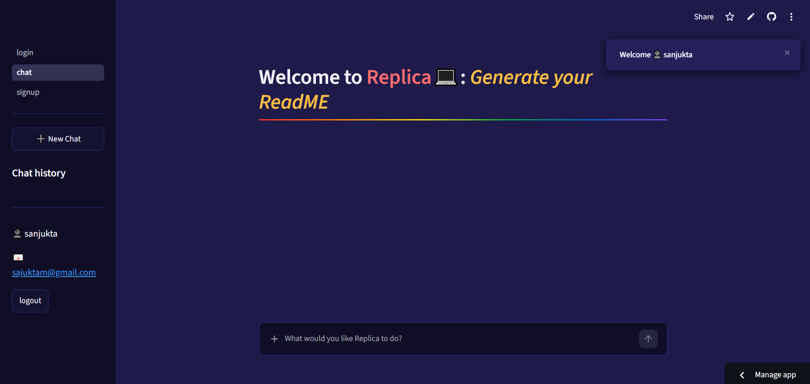
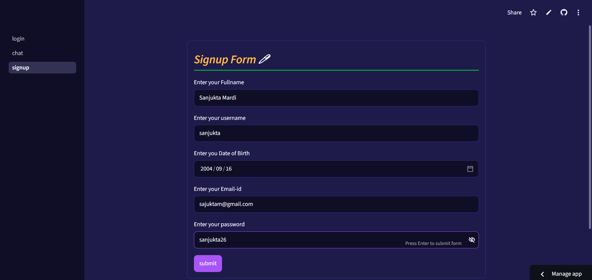

Replica

An AI-powered GitHub repository assistant that analyzes codebases, generates professional README documentation, and helps investigate bugs and errors.

Overview

Replica is an AI-powered assistant designed to simplify GitHub repository understanding and documentation. Users can provide a GitHub repository URL to analyze its structure, explore files, generate README documentation, and investigate code-related issues.

Built using Agno's multi-agent architecture, Replica coordinates specialized AI agents to perform repository analysis and documentation tasks.

Features

Agentic GitHub Repository Analysis: Examines repository information, branches, programming languages, directory structures, and file contents.

AI-Powered README Generation: Generates structured and editable Markdown documentation based on verified repository information.

Bug and Error Investigation: Helps investigate code-related issues and provides actionable debugging guidance.

GitHub Integration: Uses GitHub tools to retrieve repository information and inspect source files.

User Authentication: Provides login and signup functionality.

Conversation History: Stores user conversations and chat history using MySQL.

Docker Support: Provides containerized application and database deployment using Docker Compose.

How It Works

Replica uses an Agno multi-agent team operating in coordinate mode. Specialized agents collaborate to handle repository analysis and documentation generation.

Agent Architecture

1. Manager Agent

Coordinates the overall workflow.

Delegates tasks to specialized agents.

Combines the results into a user-facing response.

2. Analyst Agent

Investigates GitHub repositories using GitHub tools.

Retrieves repository information, programming languages, branches, directory contents, and file contents.

Collects verified information for README generation and bug investigation.

3. Writer Agent

Uses the Analyst's findings to generate professional README documentation.

Organizes information into structured Markdown sections.

Tech Stack

Programming Language

Python

AI and Agent Framework

Agno

OpenAI-compatible APIs

GitHub Integration

PyGithub

Frontend

Streamlit

Database

MySQL

SQLAlchemy

mysql-connector-python

Document Generation

ReportLab

python-docx

Other Libraries

greenlet

python-dotenv

Project Structure

Replica/
├── AgenticAI/
│   ├── Instructions/
│   │   ├── analyst_agent.txt
│   │   ├── manager_agent.txt
│   │   └── writer_agent.txt
│   └── agents.py
│
├── chat_history_db/
│   ├── __init__.py
│   └── chat_db.py
│
├── docker/
│   └── mysql/
│       └── init/
│           └── replica_db_backup.sql
│
├── UI/
│   ├── pages/
│   │   ├── chat.py
│   │   └── signup.py
│   └── login.py
│
├── images/
│   ├── chat_UI.png
│   ├── Login.png
│   └── Sign_Up.png
│
├── .dockerignore
├── .env.example
├── .gitignore
├── Dockerfile
├── replica_compose.yaml
├── requirements.txt
└── README.md

Installation and Setup

1. Clone the Repository

git clone https://github.com/sanjuktamardi/Replica-AI-README-Generator.git
cd Replica-AI-README-Generator

2. Create a Virtual Environment

python -m venv .venv

Activate it:

Windows:

.venv\Scripts\activate

Linux/macOS:

source .venv/bin/activate

3. Install Dependencies

pip install -r requirements.txt

4. Configure Environment Variables and Secrets

Configure the required database credentials using your local .env file.

Configure the required AI API key and GitHub access token using Streamlit secrets.

Refer to .env.example for the expected database environment variable names.

Never commit actual API keys, passwords, or access tokens to GitHub.

5. Run the Application

streamlit run UI/login.py

Running with Docker

Replica also supports containerized execution using Docker and Docker Compose.

1. Configure Environment Variables

Create a .env file in the project root containing the required MySQL credentials.

2. Configure Streamlit Secrets

Provide the required API credentials in .streamlit/secrets.toml.

3. Build and Start Containers

docker compose -f replica_compose.yaml up --build

4. Access the Application

Open your browser and navigate to:

http://localhost:8501

5. Stop the Containers

docker compose -f replica_compose.yaml down

The MySQL database uses a Docker named volume for persistent storage.
## User Interface (UI)
### 1.***Chat Interface***

### 2.***Login Interface***

### 3.***Signup Interface***

Feedback and Contributions

Thank you for taking the time to explore Replica!

If you encounter bugs, identify issues, or have ideas for new features and improvements, feel free to connect with me. Feedback and contributions are always welcome.

I'd love to hear your thoughts and make Replica better! 😊
